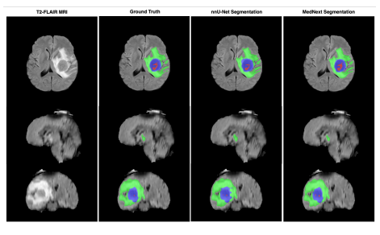

      

          
# Hi, I'm Chantelle Amoako-Atta 👋🏾               
                                                                                            
I'm a **AI/ML Engineer, PhD Researcher in AI for Decarbonisation, University College Dublin, 2025, and Data Science and Machine Learning Educator**.  
My work blends **AI, education, climate, and mathematics**, and I focus on building real-world systems  that move from **research to production**.                                                                            
   
I've developed AI solutions across **NLP, computer vision, geospatial analysis, business and reinforcement learning**, and deployed full-stack applications that support communities ranging from **teachers in Ghanaian classrooms** to **judges in international hackathons**, to **companies building intelligent products across Africa**.  

I also teach MSc and professional students in Python, R, and Machine Learning, and mentor aspiring data scientists through long-term learning programs.                  
                                                                     
📬 **Find me online**:
  
  
  <a href="https://chantelleaa.github.io" target="_blank">
    
---
                                                           
# 🔬 Current Research – Climate & Geospatial AI  

As a **PhD Researcher in Decarb-AI at University College Dublin**, I focus on applying AI to climate, energy, and environmental systems. My work explores:  

- ⚡ **Wind Turbine Design by predicting extreme wind events**

Other research projects I've worked on which are not directly related to my PhD include:  

- 🌍 **Remote sensing & geospatial AI** (Sentinel, Copernicus, OpenEarthMap)  
- 🔥 **Knowledge Distillation for improved biodiversity segmentation** (teacher–student architectures for segmentation with UNetFormer, FT-UNetFormer & DCSwin)  
- 🌫 **Air-quality analysis & pollution mapping** using multi-city datasets obtained from ECMWF and Copernicus 
- 📝 **OCR & Document AI** – Researching and benchmarking optical character recognition systems for low-resource languages and document processing  
- 🗺 **Geospatial demand modeling & spatial market intelligence** – demand indexing, expansion targeting, customer density analysis, and region-level opportunity scoring
- 🔗 **Graph-based analytics & relationship modeling** – product affinity analysis, merchant clustering, bundle recommendation logic, and network-based insights 

---

## Featured Projects  

### 🌬️ Galetech RAG Chatbot – Wind Turbine Fault Diagnosis  

A **retrieval-augmented generation (RAG) chatbot** for wind turbine technicians at Galetech, enabling plain-English queries over alarm codes, site records, and maintenance history — with every answer grounded in real operational data.  
- Entity extraction pipeline pulls alarm codes, site names, and turbine types from natural language queries  
- Cascading CSV search across Sites, fault manuals, and MMS maintenance records with fallback broadening  
- Streaming GPT-4.1 responses with clickable source popups so technicians can inspect the raw records  
- Suggested follow-up questions and session persistence for continuous troubleshooting workflows  
- Deployed on Vercel with Galetech branding and mobile-first responsive design  

[🔗 GitHub Repo](https://github.com/ChantelleAA/galetech-rag) • [How it works](https://galetech-rag.vercel.app/flow_diagram.html) • 
[Architecture & Pipeline Breakdown](https://github.com/ChantelleAA/ChantelleAA/blob/main/galetech_pipeline.html)  
**Stack:** Python, Next.js 16, TypeScript, GPT-4.1, Vercel AI SDK, Tailwind CSS, csv-parse 

### 🔋 RTE Energy Research – Pollution & Climate Dashboard

Developed multi-city pollution dashboards as part of the a research done for RTE Investigates story on the cost of renewable energy:  
- Air-quality analytics for Urumqi, Lanzhou, Taiyuan & others  
- Satellite bounding box extraction + ground sensor fusion  
- Trend analysis, geo-scatter maps, and city comparison tools  
- Used for internal Decarb-AI research insights  

[🔗 GitHub Repo 1 (Analysis)](https://github.com/ChantelleAA/urumqi_analysis) • [🔗 GitHub Repo 2 (Dashboard)](https://github.com/ChantelleAA/pollution_viz)  
**Stack:** Python, Streamlit, GeoPandas, Plotly, Pandas  

---

### 🧑🏾‍⚖️ Quantathon Judging App  

A Django-based hackathon judging platform used in the **AIMS Quantathon 2024** with 50+ participants.  
- Real-time leaderboard & analytics  
- Criteria filtered by judge expertise  
- One-time secure voting links  
- Admin dashboard for managing live events    

[🔗 GitHub Repo](https://github.com/ChantelleAA/judging_criteria) • [📰 Press Coverage](https://www.linkedin.com/posts/african-institute-for-mathematical-sciences-ghana_aimsqtedu25-quantumforgood-quantathonwinners-activity-7353129321454100482-uauo)  
**Stack:** Django, PostgreSQL, HTMX, Railway  

---

### 📘 TLR Helper – Teaching & Learning Resource Assistant  

A web app supporting Ghana's **Standards-Based Curriculum**, for teachers used in TEDD Ghana teacher workshops and in Ghanaian Classrooms.    
- Smart curriculum filtering (Class → Content Standard → Strand → Substrand → Indicator)  
- Offline PDFs for schools with limited internet  
- Built-in support for special needs and learning styles  

[🔗 GitHub Repo](https://github.com/ChantelleAA/tlr_app)  
**Stack:** Django, HTMX, PostgreSQL, Bootstrap5  

---

### 🧠 Brain Tumor Segmentation (MICCAI)  

Developed **ensemble models** to improve segmentation on Sub-Saharan MRI data.  
- Awarded a **MICCAI 2023 Scholarship** to present this work internationally  
- Proposed new methods (Staple Assembling & Mednex) for better outcomes  
- Focused on real-world challenges in resource-limited healthcare  

[📄 Research Paper](https://arxiv.org/abs/2508.10905) • [📜 Certificate](https://drive.google.com/file/d/1Mhlt9DPoW-HOK1Ky5_jtWJBCNLwpWW6M/view?usp=sharing)  
**Stack:** PyTorch, MONAI, NumPy, Python  

---

### 🤖 NileEdge AI Assistant  

A context-aware chatbot with **semantic FAQ matching + Whisper transcription**, built for NileEdge Innovations.  
- Hybrid retrieval + LLM inference  
- Privacy-first: runs entirely locally  
- Custom UI + automatic FAQ expansion  
   
[🔗 GitHub Repo](https://github.com/ChantelleAA/response_aigent)  
**Stack:** Python, Flask, ChromaDB, Whisper  

---

### 🎮 Oware Nam-nam Reinforcement Learning  

Built a full Python environment for the traditional game **Oware** and trained multiple agents.  
- Implemented DQN, DDQN, A3C, AlphaZero  
- Human-vs-agent and agent-vs-agent play modes  
- Reward tracking and gameplay visualization  

[🔗 GitHub Repo](https://github.com/ChantelleAA/Reinforcement_Learning_Oware) • [📄 Thesis Paper](https://lutpub.lut.fi/bitstream/handle/10024/167861/mastersthesis_Amoako-Atta_Chantelle.pdf?sequence=1&isAllowed=y)  
**Stack:** Python, TensorFlow, Stable-Baselines  

---

## 🌍 AI Sandbox – GeoSeg Biodiversity Segmentation  

Led geospatial AI work for **ODOS Tech**, building a biodiversity segmentation pipeline using Sentinel/OpenEarthMap.  
- Improved mIoU from **68–72% → 87–90%**  
- Designed **Knowledge Distillation** teacher–student framework  
- Implemented full training, evaluation & post-processing pipeline  
- Delivered reproducible results for land-cover classification  

[🔗 GitHub Repo 1 (Analysis)](https://github.com/ChantelleAA/geoseg) • [🔗 GitHub Repo 2 (Image Generation)](https://github.com/ChantelleAA/geseg_GAN)  
**Stack:** PyTorch, UNetFormer, FT-UNetFormer, DCSwin, GeoPandas, Rasterio, GDAL

---

### 📄 OCR Research & Evaluation  
Comprehensive research project evaluating state-of-the-art OCR tools for document processing.   
- Benchmarking multiple OCR engines (Tesseract, EasyOCR, PaddleOCR, etc.)  
- Performance metrics comparison across different document types  
- Preprocessing pipeline optimization for improved accuracy  
- Focused on low-resource language support and real-world applications  

**Stack:** Python, Tesseract, EasyOCR, PaddleOCR, OpenCV, PIL       

---  

### 🌍 GeoAI Workshop – Satellite Data & Land Cover Analysis  

Workshop materials and teaching resources for geospatial AI and environmental monitoring.  
- Hands-on tutorials for satellite imagery processing  
- Land cover classification using machine learning  
- Environmental data analysis with Python  
- Jupyter notebooks for remote sensing applications  

[🔗 GitHub Repo](https://github.com/ChantelleAA/gain_geoai_workshop)  
**Stack:** Python, Jupyter Notebook, GeoPandas, Rasterio, Satellite Imagery, QGIS  

---

## 🏆 Recognition  

- 🎖 **MICCAI Scholar (2023)** – Presented brain tumor segmentation at an international conference. [📜 Certificate](https://drive.google.com/file/d/1Mhlt9DPoW-HOK1Ky5_jtWJBCNLwpWW6M/view?usp=sharing)  
- 🛰 **AI Sandbox Participant - Biodiversity Segmentation** – GeoSeg biodiversity segmentation.  
- 🌍 **PhD Researcher – Decarb-AI (UCD)** – AI for climate & energy.  
- 🏆 **Hackathon Winner** – 1st place in an international hackathon (Boise State, MIT, Tanzania universities).  
- 🥇 **Quantathon Mentor** – Guided team "Qualaria" to win + sustainability award. [📰 Coverage](https://www.linkedin.com/posts/african-institute-for-mathematical-sciences-ghana_aimsqtedu25-quantumforgood-quantathonwinners-activity-7353129321454100482-uauo)  
- 📢 **Lecturer – AIMS Ghana (2025)** – Delivered a two-week MSc NLP module, from preprocessing → chatbot architectures, using Hugging Face, spaCy, NLTK, and Gradio.  
- 🌍 **Senior Data Science Mentor – Thrive Africa (2025)** – Mentored learners in data science & ML, and co-led a workshop with University of Ghana societies. [📰 Workshop Link](https://www.linkedin.com/feed/update/urn:li:activity:7352575997126311936/)  
- 👩🏾‍🏫 **Mentor – FemAfricMaths / Divas in AI (2025)** – Supporting young women in STEM across Africa.  
- 🌐 **Speaker – Ghana NLP Community (2025)** – Invited speaker at the monthly *Learn + Connect* session, sharing my journey in NLP/ML with the community.  
- 🤝 **Member – Ghana NLP Community (2025–Present)** – Part of Ghana's leading network for NLP developers, linguists, and researchers building tools for local languages. [🌍 GhanaNLP](https://ghananlp.org)  
- ✍️ **Published Research** – [Brain Tumor Segmentation (arXiv)](https://arxiv.org/abs/2508.10905) • [Reinforcement Learning Thesis](https://lutpub.lut.fi/bitstream/handle/10024/167861/mastersthesis_Amoako-Atta_Chantelle.pdf?sequence=1&isAllowed=y)  
- 📚 **Educator** – Trained 200+ Undergraduate, MSc and professional students in Python Programming, ML & Data Science.  
- 🎤 **Public Speaker** – Spoke at seminars on Teaching Practices, Generative AI and Breaking into AI from diverse educational backgrounds.

---  

## 🎓 Teaching & Mentorship  

- 🎓 Led a year-long **Coding Club at AIMS Ghana**, teaching MSc students Python & R → now building data science/ML projects independently.  
- 📘 **Lecturer & Tutor (AIMS Ghana, 2025–Present)** – Taught a two-week MSc **NLP module** covering preprocessing, sentiment analysis, chatbot design, and modern toolkits (Hugging Face, spaCy, NLTK, Gradio).  
- 📘 Teach professional students at **Adaire Academy**, supporting their EPFL diploma in **Data Science & Machine Learning**.  
- 🧕🏾 Taught Python & Intro to AI at the **AIMS Girls in Mathematical Sciences Program (GMSP)** residential workshop.  
- 🌍 **Senior Data Science Mentor (Thrive Africa, 2025–Present)** – Supporting learners in the Campus & Graduate Data Science programs with mentorship in Python, TensorFlow, and ML best practices. [📰 Workshop Highlight](https://www.linkedin.com/feed/update/urn:li:activity:7352575997126311936/)  
- 👩🏾‍🏫 **Mentor – Divas in AI / FemAfricMaths (2025–Present)** – Mentoring young women in STEM, focusing on mathematics, data science, and AI.  
- 🎓 Mentor in a **34-week one-on-one AI course**, guiding learners from fundamentals to advanced applied ML.  
- 🌍 **GeoAI Workshop Instructor (GAIN, 2025)** – Designed and delivered hands-on workshop on geospatial AI using Python, covering satellite imagery processing, land cover classification, and environmental data analysis with GeoPandas, Rasterio, and remote sensing tools.  

---

## ✍️ Recent Writings  

- [Intro to Python – Part 1: Temperature Converter](https://chantelleaa.github.io/archivers/introduction-to-python-in-6-lessons-part-1)  
- [Intro to Python – Part 2: Simple Calculator](https://chantelleaa.github.io/archivers/introduction-to-python-in-6-lessons-part-2)  
- [Gradio Part 1: Build ML Interfaces](https://chantelleaa.github.io/archivers/intro-to-gradio-part-1)  
- [Gradio Part 2: Personality Prediction](https://chantelleaa.github.io/archivers/intro-to-gradio-part-2)  
- [3 Ways I Scrape the Web](https://chantelleaa.github.io/archivers/intro-to-web-scraping)  

> More at [chantelleaa.github.io](https://chantelleaa.github.io)  

---

## 🛠 Tech Stack  

---

## 📊 GitHub Activity  
<table>
  <tr> 
    <td> 
      
    </td> 
    <td> 
       
    </td> 
    <td> 
       
    </td> 
  </tr> 
  <tr> 
    <td colspan="2"> 
       
    </td> 
    <td> 
       
    </td> 
  </tr> 
</table>
